<div align="center">
  
  <h1>DeepForge Studio</h1>
  <p><strong>Professional Research Toolkit · Jade Edition</strong></p>
  <p>Created by <strong>Alireza Khatibi</strong> · XVARNA</p>
  <p>Developed by XVARNA &amp; Bushehr Machine Vision.</p>
</div>

  

**Inspect · Validate · Evaluate · Reproduce**

DeepForge is a local-first research toolkit for deep learning and computer vision. It brings dataset quality checks, leakage audits, YOLO label validation, experiment diagnostics, classification evaluation, model inspection, and reproducibility reporting into one Python package with a desktop interface and a scriptable command-line API.

DeepForge Studio is an early-stage open-source project for research and development, not a clinically validated product or a certified production service. This documentation targets version 0.7.1.1.3. See [PyPI](https://pypi.org/project/deepforge-research-toolkit/) for available distributions.

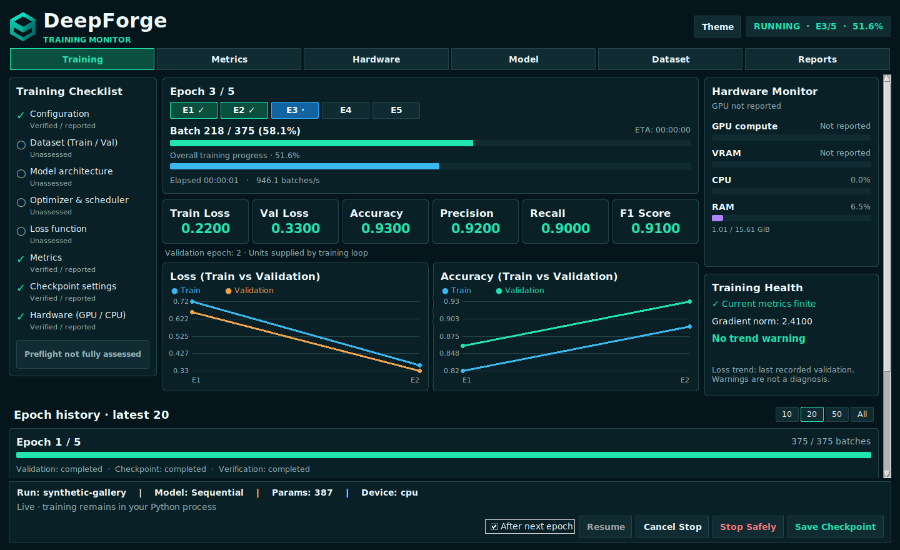

*Actual native desktop window captured in the Linux/Xvfb CI gallery. Training metrics are synthetic demonstration observations, not a model benchmark; hardware readings reflect the capture environment.*

## Install and launch

### Choose the interface

All four interfaces coexist; the research Studio is not replaced by the new monitor.

| Interface | Where it runs | How to launch |
| --- | --- | --- |
| Research Studio (12 data / evaluation workspaces) | Local Windows, Linux or macOS with Tkinter | `deepforge-studio` or `python -m deepforge.gui` |
| Inline notebook dashboard | Google Colab, Kaggle, VS Code and local Jupyter kernels | `NotebookMonitor(live_json_path)`, then `view.refresh()` from the caller's training loop |
| Advanced native training monitor | Local scripts/notebooks with a graphical display and Tkinter | `session.open_desktop()` for a connected training session; `deepforge-monitor PATH_TO_RUN/live.json` for read-only viewing |
| Legacy live training viewer | Local graphical desktop | `deepforge-live PATH_TO_RUN/live.json` |
| Command-line / headless analysis | Terminal, CI, server | `deepforge --help` |

**Installed package vs. source checkout.** Use the distribution name `deepforge-research-toolkit`. For an exact-version PyPI install, verify that the documented release is listed on PyPI first. If it is not yet available, clone this repository and install from its root:

```bash
git clone https://github.com/AliRezaKhatibi/DeepForge.git
cd DeepForge
python -m pip install -e ".[images,notebook,resources,interactive]"
```

PyTorch is an optional dependency: use its official installation guide for the appropriate hardware. With a notebook, install in the selected kernel and restart after updating already imported dependencies.

```python
from importlib.metadata import version
print(version("deepforge-research-toolkit"))
```

Check Tkinter locally with `python -m tkinter`; hosted Colab/Kaggle should use the inline dashboard, not a separate Tk window. For a full walkthrough of setup, MNIST training, stopping, checkpointing and resuming, see [Complete training quickstart](#complete-training-quickstart-colab-kaggle-jupyter-and-vs-code).

### Advanced desktop training monitor (0.7.1.1.3)

The native desktop monitor is an **optional independent window** for local scripts
and notebooks in VS Code, PyCharm or a terminal. It does not replace the existing
Colab/Jupyter inline monitor or the legacy `deepforge-live` viewer. The six English
views (Training, Metrics, Hardware, Model, Dataset, Reports) show actual recorded
data, not estimates of unreported measurements. Validation cards identify their
last recorded epoch. The default jade palette is based on the approved reference;
the transparent SVG/PNG/ICO symbol is a vector reconstruction, not an original
vector master.
The Model view lists up to 100 registered modules and direct parameter counts;
Reports exports the recorded snapshot as JSON or completed epoch data as CSV.

<details>
<summary>Explore all six native monitoring views</summary>

**Training** — progress, validation metrics, checklist, resources and training health.


**Metrics** — recorded training and validation observations, with epoch charts.

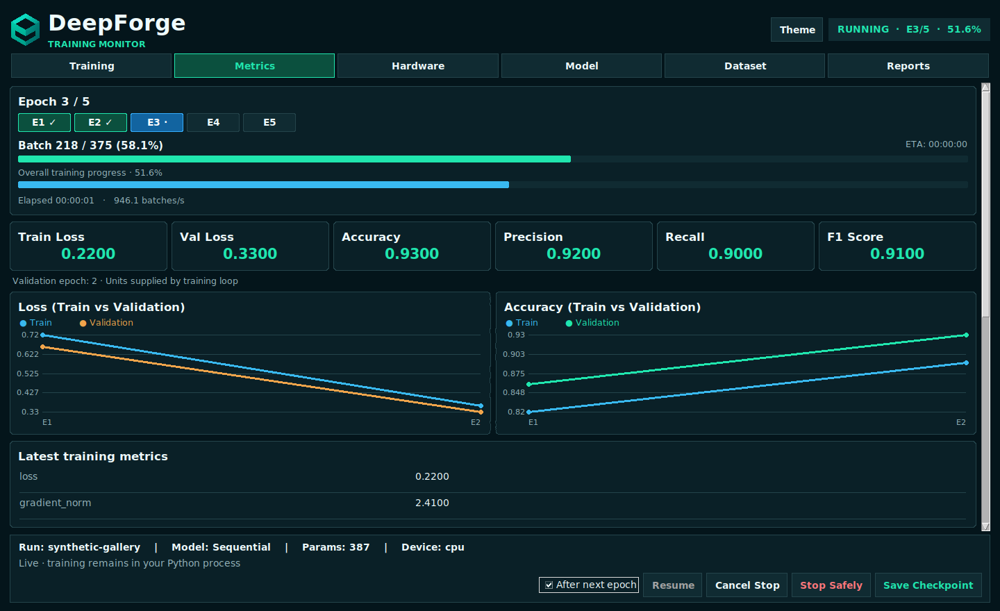

**Hardware** — available CPU, RAM, GPU and VRAM readings.

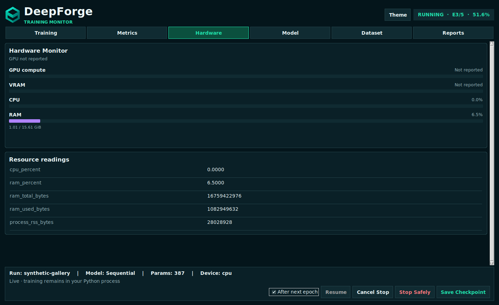

**Model** — registered module inventory and parameter counts.

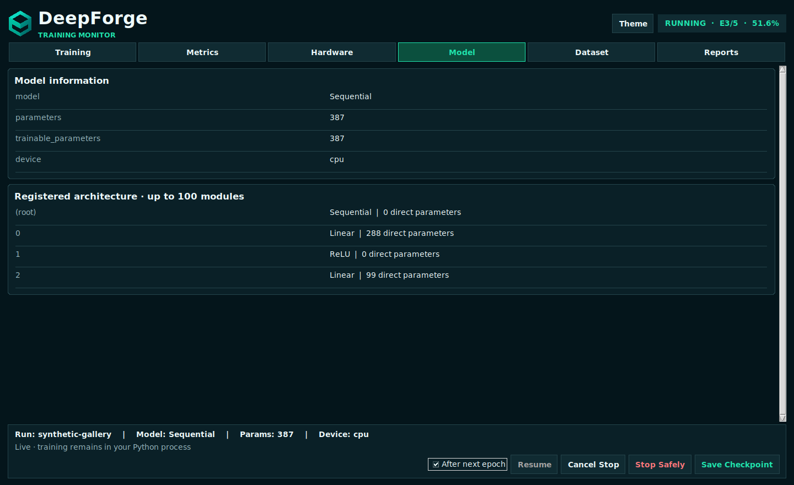

**Dataset** — caller-supplied metadata and recorded batch distribution.

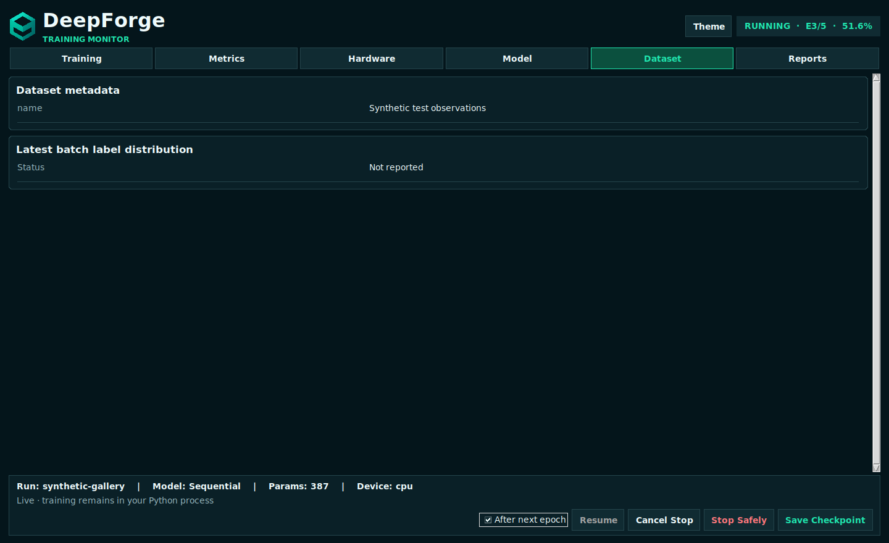

**Reports** — recorded artifacts, diagnostics and JSON/CSV exports.

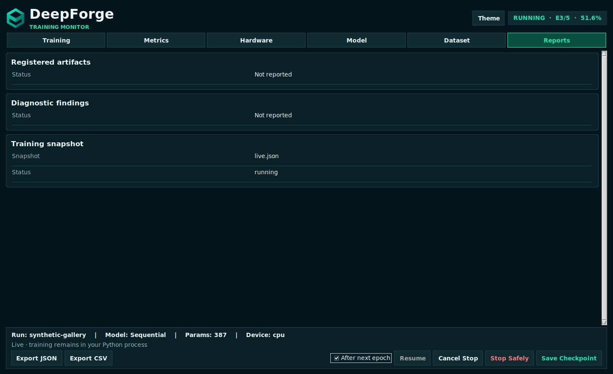

All screenshots are from the actual native window in the [verified gallery run](https://github.com/AliRezaKhatibi/DeepForge/actions/runs/46085808783). Synthetic metric values are not evidence of model performance.

</details>

In a local VS Code notebook, use the established `build_training_session(...)` and
`NotebookMonitor` workflow exactly as before. To additionally open the advanced
native window, run this after building the session:

```python
desktop = session.open_desktop()
```

Alternatively, pass `desktop=True` to `build_training_session(...)`. The window
uses the same Python interpreter and a separate local process; training keeps
running if it is closed. A local graphical display and Tkinter are required
(`python -m tkinter` checks availability). Do not use the desktop option in hosted
Colab, Kaggle or another headless runtime. An existing local snapshot can be
viewed read-only without a session:

```bash
deepforge-monitor /path/to/live.json
```

For stop/cancel/save, the training loop must call `session.epoch_boundary(...)`
after validation and scheduler updates, as in the existing session examples.
The desktop control channel remains responsive while the caller is training;
requests are acknowledged at safe epoch boundaries. Manual saves use a separate
verified checkpoint store, even when periodic saving is disabled. The optional
resume button requires the caller to opt in with
`session.open_desktop(allow_resume=True)` and call
`session.wait_for_resume_request()` after pausing, then rebuild a matching session,
call `restore()` and restart the caller-owned loop at the next epoch. It cannot
execute arbitrary user training code. Without that opt-in, the UI explains how to
resume using the established recovery API. All existing notebook controls remain
unchanged. See [the local example](examples/desktop_training.py) for a complete workflow.

Python 3.10 or later is required. The core toolkit uses only the standard library. Pillow enables image decoding and similarity analysis; PyTorch is optional for model inspection. Tkinter is required only for the desktop application.

### Windows

Extract the source archive and open its `DeepForge` directory. With Python on PATH, run `scripts\setup-windows.cmd` and then `scripts\launch-windows.cmd`. The setup script creates a project-specific `.venv` and installs the image-analysis dependency. Alternatively, use your existing Python environment:

```powershell
python -m pip install -e ".[images]"
python -m deepforge.gui
```

### Linux / macOS

```bash
python -m venv .venv
source .venv/bin/activate
python -m pip install -e '.[images]'
deepforge-studio
```

A standard Tk installation is needed. On Debian/Ubuntu, install `python3-tk` if your Python distribution does not already include Tk. Check with `python -m tkinter`. Install PyTorch for your hardware using the official [PyTorch installation guide](https://pytorch.org/get-started/locally/) rather than assuming a CUDA build is appropriate. For a default PyTorch installation, `python -m pip install -e '.[torch]'` is also available.

The Windows launch scripts have been inspected but not run on Windows in the release preparation environment. The actual desktop UI was exercised on Linux with a virtual display. GPU execution has not been validated.

### Google Colab and VS Code notebooks

In Colab, install into the active kernel without upgrading its preinstalled IPython:

```python
%pip install deepforge-research-toolkit==0.7.1.1.3
```

In VS Code, install the Python and Jupyter extensions, select your Python environment as the notebook kernel, and run `%pip install -e ".[notebook]"` from the repository root in that kernel. Restart the kernel if upgrading an already imported package.

Open [the synthetic notebook example](examples/notebook_compatibility.ipynb) ([Colab](https://colab.research.google.com/github/AliRezaKhatibi/DeepForge/blob/main/examples/notebook_compatibility.ipynb)). Install the package before running its cells. The new `NotebookMonitor(path, interval=1.0)` uses an IPython display handle; call `refresh()` after recording batches and `refresh(force=True)` after finishing. Set the TrainingMonitor publish interval to suit the refresh interval. No Tk window, server or background thread is required. Colab files are ephemeral unless explicitly copied to persistent storage. VS Code scripts can continue using the CLI and desktop viewer.

CI executes the notebook in standard headless Jupyter kernels on Windows and Linux. This does not establish actual hosted Colab or VS Code frontend rendering compatibility. GPU hardware validation is deferred.

## Runnable notebook examples and visual gallery

Open each notebook from GitHub or in Colab. In VS Code, open its `.ipynb` file, select the Python/Jupyter kernel in which DeepForge is installed, and run the cells in order. Installation snippets and environment notes are included.

| Notebook / example | What it demonstrates | Open |
| --- | --- | --- |
| Notebook smoke demo | Three recorded demonstration batches; no model training | [Notebook](examples/notebook_compatibility.ipynb) · [Colab](https://colab.research.google.com/github/AliRezaKhatibi/DeepForge/blob/main/examples/notebook_compatibility.ipynb) |
| NumPy neural-network training | Real CPU training, loss, accuracy, epoch validation and inline monitor; no PyTorch or data download required | [Notebook](examples/numpy_training_monitor.ipynb) · [Colab](https://colab.research.google.com/github/AliRezaKhatibi/DeepForge/blob/main/examples/numpy_training_monitor.ipynb) |
| PyTorch training and recovery | Real synthetic classification, optional notebook controls/native monitor, safe pause and explicit checkpoint restore | [Notebook](examples/pytorch_session_monitor.ipynb) · [Colab](https://colab.research.google.com/github/AliRezaKhatibi/DeepForge/blob/main/examples/pytorch_session_monitor.ipynb) |
| Local native desktop training | Standalone PyTorch script with the independent advanced window | [Python example](examples/desktop_training.py) |
| Complete MNIST walkthrough | Dataset download, split, training, validation and recovery cells | [README guide](#complete-training-quickstart-colab-kaggle-jupyter-and-vs-code) |

The NumPy notebook was executed with the 0.7.1.1.3 source: 20 epochs, 320 optimizer updates, actual training/validation measurements, initial validation accuracy 56.25%, final validation accuracy 95.31% and final validation loss 0.2532. These are synthetic-data demonstration results, not a benchmark. The PyTorch notebook was syntax-checked and its API calls checked against the source; full execution requires a PyTorch-equipped kernel.

### Inline training dashboard (Colab / VS Code / Jupyter)

The inline interface is rendered **inside the notebook output cell**. The same HTML renderer is used in compatible IPython notebooks. This screenshot shows the repository's earlier CI browser rendering of the notebook interface with synthetic demo observations, not a captured hosted Colab or VS Code session.

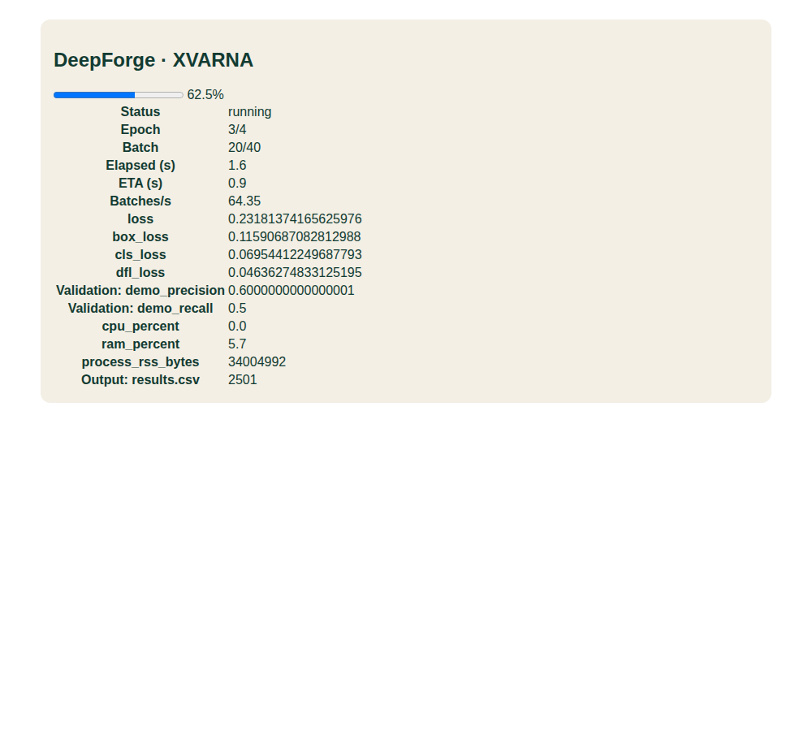

For a current real-training example, download and open these exact HTML snapshots produced by the executed NumPy notebook. They are self-contained examples of what the renderer displays at a running and completed state:

- [During training (epoch 8, batch 8)](docs/images/notebook-training-in-progress.html)
- [Completed training (epoch 20)](docs/images/notebook-training-completed.html)

The following chart plots the **recorded** training and validation values from that same run; it is not a screenshot or fabricated model benchmark.

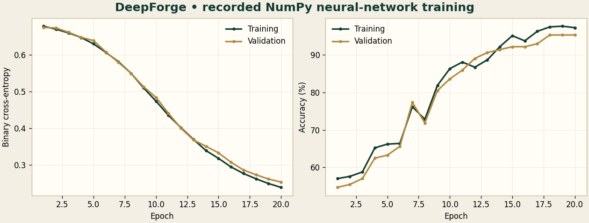

### Local graphical interfaces during training and research

From a local VS Code notebook or Python script, optionally open `session.open_desktop()` after constructing the training session. The native window is independent of the notebook output. Open an existing snapshot with:

```bash
deepforge-monitor "PATH_TO_RUN/live.json"
```


For research/data inspection, open `deepforge-studio`:


Native screenshots come from the running application's existing CI gallery using synthetic demonstration observations. Hosted Colab and VS Code frontend rendering, widget callbacks and GPU behavior still require environment-specific verification; these screenshots do not claim to capture those frontends.


## Research workspaces

| Workspace | Purpose | CLI command |
| --- | --- | --- |
| Dataset Inspector | Split and class counts for image classification | `dataset` |
| Exact Duplicates | SHA-256 cross-split duplicate groups | `leakage` |
| Image Integrity | Decode images, inspect resolution/mode, flag perceptual similarities | `images` |
| Group Leakage | Detect group, subject, or patient IDs shared across splits | `groups` |
| YOLO Labels | Check detection labels, class ranges, missing/orphan pairs, invalid boxes | `yolo` |
| Learning Curves | Best epoch, final metric, possible overfitting signal | `history` |
| Compare Runs | Rank validation histories and identify rejected CSV files | `compare` |
| Classification | Accuracy, macro/weighted precision, recall, F1 and confusion matrix | `metrics` |
| Binary Scores | ROC-AUC, average precision, threshold metrics, Brier score and ECE | `scores` |
| Model Inspector | Parameters, executed layers, shapes, partial MACs/FLOPs and latency for a configurable MLP | `profile-mlp` |
| Runtime | Python, PyTorch and optional CUDA information | `env` |
| Reproducibility | Dependency versions and optional input-file SHA-256 | `manifest` |

### Studio features


- A navigable research dashboard, 12 independent workspaces, with a jade, cream and gold visual identity, collapsible sidebar and searchable navigation. Compact windows automatically collapse the input panel after analysis to leave room for the chart.
- Workspace input values are retained during the session. Search findings, copy individual rows, and hover over plotted points for precise values.
- Explore binary decision thresholds interactively with live precision, recall and F1 previews; Apply explicitly recomputes the report. Threshold selection belongs on validation data, not the final test set.
- Background analysis keeps the UI event loop responsive; analyses are run sequentially within a window.
- Learning curves, confusion matrices, distribution bars, ROC, precision-recall and reliability diagrams.
- A findings table and full JSON report; JSON and self-contained HTML export with embedded chart previews matching the selected ROC, precision-recall or calibration view.
- The last 15 successful analyses are available in session memory. Closing the application clears that history unless reports were explicitly exported.
- Nine workspaces have bundled, clearly synthetic demo inputs. Demo data intentionally includes leakage and label issues to exercise the audits.
- No account, cloud service or telemetry is required. Input analyses are read-only, and report exports are written to a user-selected output path.

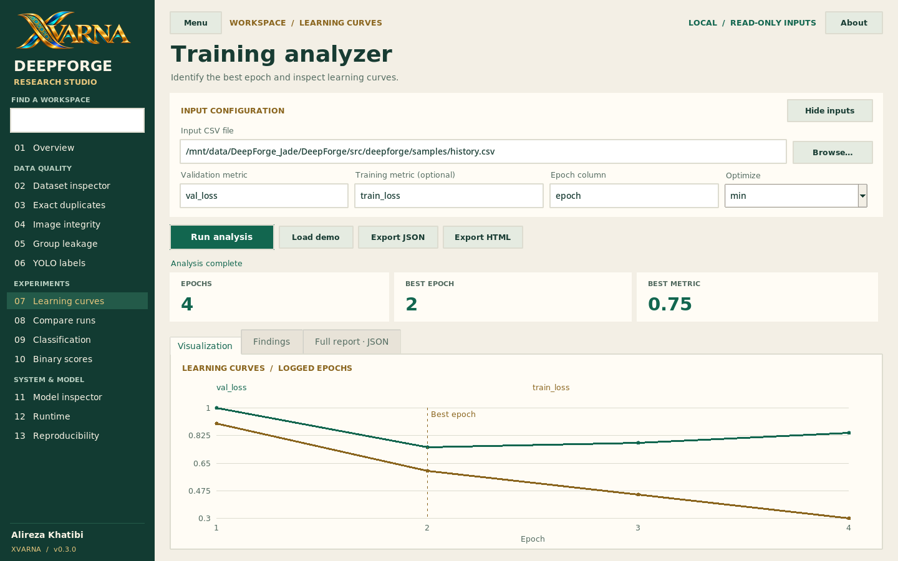

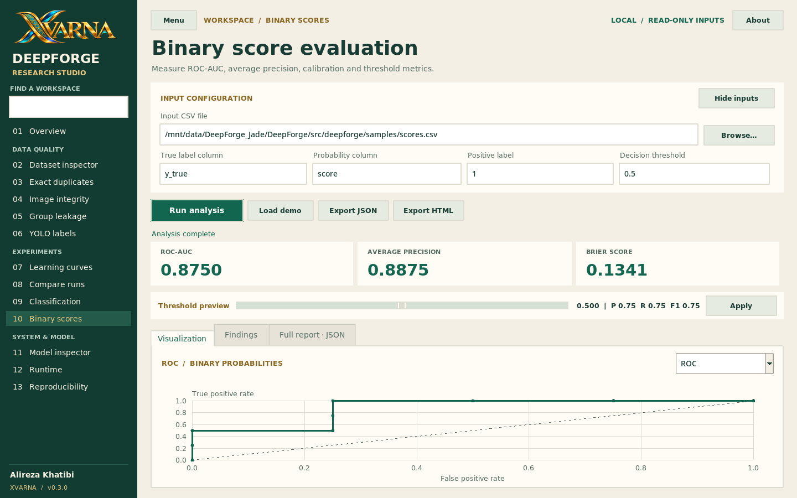

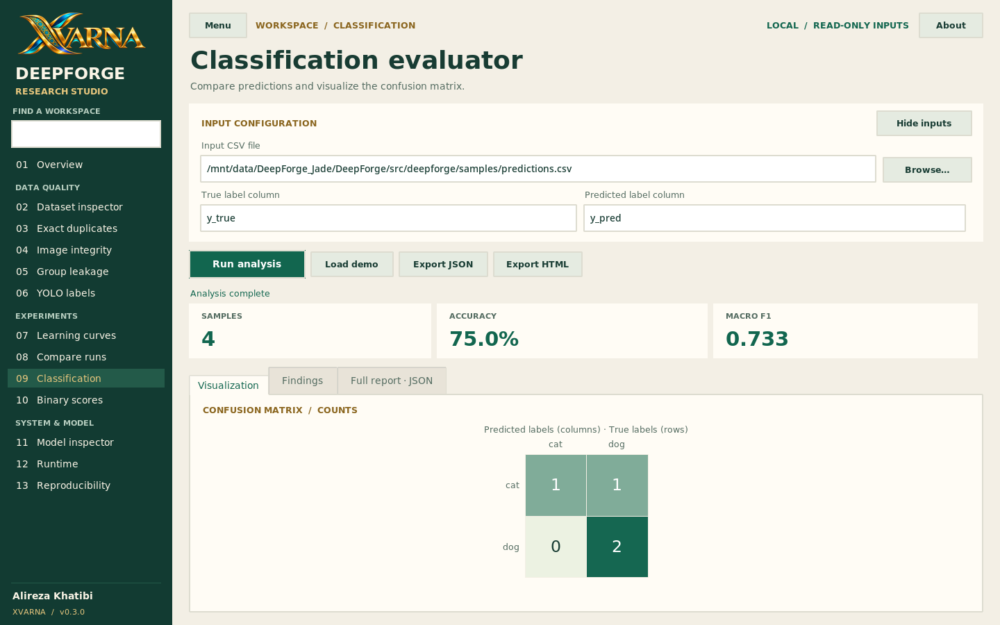

<details>
<summary>Explore more real application screenshots</summary>

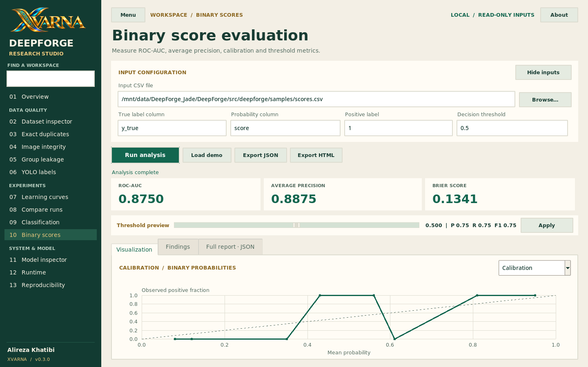
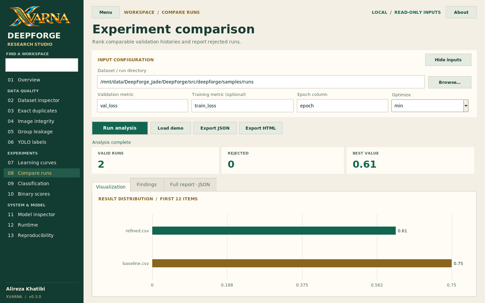


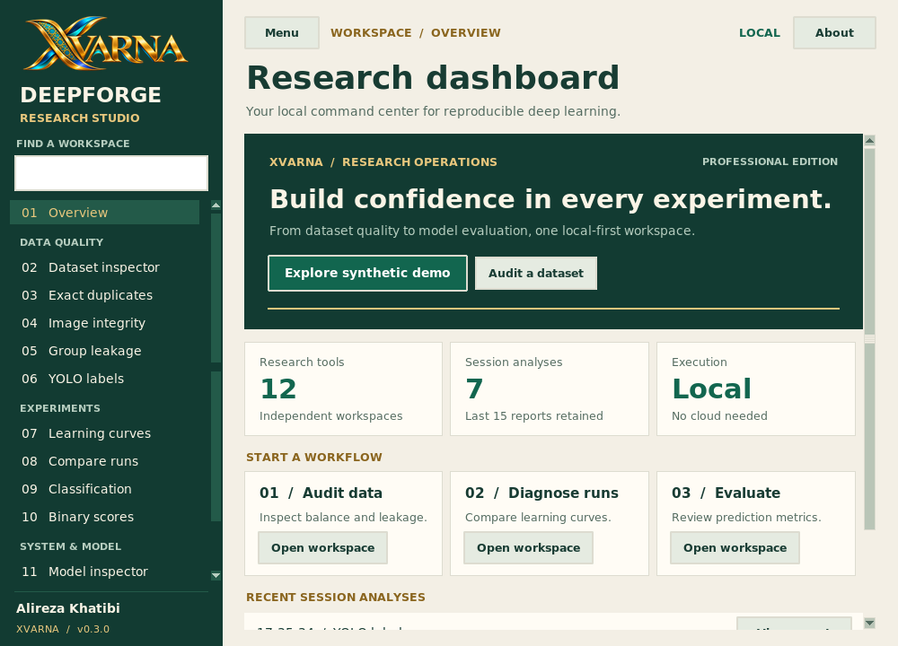
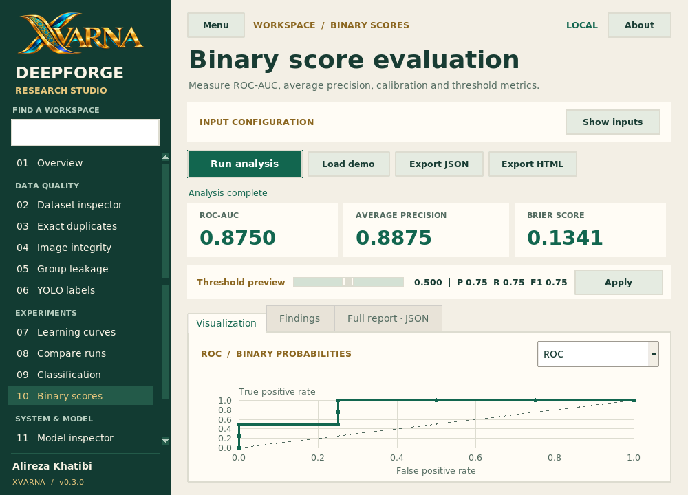


</details>

All screenshots were captured from the running desktop application with bundled synthetic inputs. No private datasets are included.

### Keyboard shortcuts

| Shortcut | Action |
| --- | --- |
| Ctrl+K | Find a workspace |
| Ctrl+B | Toggle sidebar |
| Ctrl+Enter | Run analysis |
| Ctrl+S | Export JSON |

### Branding

DeepForge Studio was created by Alireza Khatibi under the XVARNA identity. The supplied XVARNA logo was refined into a transparent raster asset for the desktop application and documentation. The software uses the MIT license; brand identity and logo usage are separate from the software license.

## CLI quick examples

Run `deepforge --help` or `python -m deepforge --help` for arguments. All CLI reports are JSON. Exit code 2 indicates an invalid input or I/O error. The `leakage` and `groups` commands can return 1 with `--fail-on-leakage` when the respective audit detects overlap.

```bash
deepforge dataset ./dataset
deepforge leakage ./dataset --fail-on-leakage
deepforge images ./dataset --similarity --threshold 4 --max-images 2000
deepforge groups examples/groups.csv --fail-on-leakage
deepforge yolo ./detection_dataset --classes 3
deepforge history examples/history.csv --train-metric train_loss
deepforge compare examples/runs --train-metric train_loss
deepforge metrics examples/predictions.csv
deepforge scores examples/scores.csv --positive-label 1 --threshold 0.5
deepforge env
deepforge manifest examples/history.csv
```

## Input formats and interpretation

### Classification datasets and image audits

```
dataset/
  train/cat/a.png
  train/dog/b.jpg
  val/cat/c.png
  test/dog/d.jpg
```

`dataset` and `leakage` expect class directories under `train`, `val` (or `validation`), and/or `test`. The first counts supported extensions without decoding; the second groups identical file bytes by SHA-256. `images` accepts both class folders and images directly beneath split folders. It uses Pillow, corrects EXIF orientation for inspected sizes and hashes, flags decode failures and reports unsupported DICOM inputs without parsing them.

Perceptual similarity is a 64-bit difference hash (dHash) compared by Hamming distance across different splits. The exhaustive comparison is bounded to a configurable, deterministic first 1–5,000 image candidates (default 2,000); pair previews are capped, and reports include explicit truncation indicators. It may miss cropped, rotated or otherwise transformed images, and unrelated flat images can collide. These are candidate matches requiring review, not proof of duplicate identity. Clean reports do not establish patient independence. The image audit inspects a single frame of multi-frame images and rejects images exceeding 40 megapixels.

### Group-aware leakage

```csv
group_id,split
subject-a,train
subject-a,val
subject-b,test
```

The manifest must include complete, correct group IDs. Use patient-level identifiers in medical imaging where ethically permitted; do not upload real identifiers or datasets to GitHub. Raw IDs are replaced with local report pseudonyms by default; this is not guaranteed anonymization. `--show-identifiers` is an explicit CLI opt-in. Group audits do not infer patient identities from filenames or image content.

### YOLO object detection

```
detection_dataset/
  images/train/a.jpg
  labels/train/a.txt
  images/val/b.jpg
  labels/val/b.txt
```

Each detection row has five fields: `class_id x_center y_center width height`. Coordinates must be finite and normalized, and box dimensions must be positive. The audit flags out-of-frame boxes, duplicate rows, invalid class IDs (upper bound only when `--classes` is supplied), ambiguous image stems and missing/orphan label files. Empty label files may correctly represent background images. This does not inspect semantic annotation correctness, YAML dataset definitions, segmentation polygons, or pose keypoints.

### Experiment diagnostics

Use CSV files with strictly increasing numeric epochs and finite numeric validation values. `--mode min` selects the smallest metric, while `--mode max` selects the largest. The earliest epoch wins ties. If a comparable training metric improves while validation deteriorates after the best epoch, the result is a possible overfitting signal, not a causal diagnosis. `compare` processes CSV files in one directory (default cap 100) and ranks reported best validation metrics; compare only runs with equivalent evaluation protocols and appropriate budgets.

### Classification and probability scores

Use `y_true,y_pred` for single-label predictions. Confusion matrix rows are true labels, columns predicted labels, using sorted observed labels. Undefined precision/recall/F1 are zero.

For binary probability evaluation, use `y_true,score`, specifying the positive class and decision threshold. Scores must be finite probabilities in [0,1], and exactly two observed classes are required. ROC-AUC integrates the ROC curve; average precision uses recall increments at grouped score thresholds (including ties). Brier score measures probability squared error, while ECE depends on the equal-width bins selected. Calibration is descriptive, not a guarantee of trustworthy predictions. Tune thresholds on validation data, not the final test set. Detection mAP, multiclass probability curves and multilabel metrics are not implemented.

### PyTorch model inspection

```python
import torch
from deepforge.models import inspect_model

model = torch.nn.Sequential(
    torch.nn.Linear(16, 32),
    torch.nn.ReLU(),
    torch.nn.Linear(32, 3),
)
print(inspect_model(model))
```

The desktop Model workspace constructs a limited configurable MLP; the Python API accepts a model you have already constructed. It never loads arbitrary checkpoints or evaluates user-supplied Python source. Parameter/buffer counts deduplicate tensor objects, but shared underlying storage can be counted more than once. Logical byte estimates are not activation memory, optimizer memory, peak GPU memory, latency or FLOPs. Initialize lazy modules before inspection.

## Python API

```python
from deepforge.audit import audit_groups, audit_yolo, audit_images
from deepforge.advanced import read_binary_scores, compare_runs

report = audit_groups('examples/groups.csv')
print(report['overlapping_groups'])
report = read_binary_scores('examples/scores.csv')
print(report['roc_auc'])
```

### API capability map

| Module | Public entry points | Purpose |
| --- | --- | --- |
| datasets | `inspect_dataset` | Dataset inventory and exact duplicates |
| audit | `audit_images`, `audit_groups`, `audit_yolo` | Image, group and annotation audits |
| advanced | `read_binary_scores`, `compare_runs` | Probability evaluation and run comparison |
| models | `inspect_model` | Model parameter and buffer inspection |
| profiler | `profile_model`, `profile_mlp`, `profile_operators`, `profile_cuda_peak` | Executed layer trace, partial MACs/FLOPs, logical bytes and forward latency |
| automation | `run_checks`, `require_pass`, `save_report` | Composable quality gates |
| training | `TrainingGuard`, `model_check`, `gradient_check` | Pre-update training health checks |
| monitor | `TrainingMonitor` | Batch progress, ETA, metrics and output files |
| ultralytics | `attach_monitor` | Opt-in trainer callbacks |
| resources | `sample_resources` | Optional CPU/RAM and CUDA allocator observations |
| notebook | `snapshot_html`, `display_snapshot` | Notebook-friendly local snapshots |

## Automated quality gates (Python integration)

Install directly from GitHub for development builds:

```bash
python -m pip install "git+https://github.com/AliRezaKhatibi/DeepForge.git"
```

Use DeepForge as a headless library without launching the desktop interface:

```python
from deepforge.automation import (
    dataset_check, group_check, run_checks, save_report, require_pass,
)

report = run_checks([
    dataset_check("dataset"),
    group_check("groups.csv"),
])
save_report(report, "quality-report.json")
require_pass(report)  # Raises AuditFailed if a check fails or errors.
# Start model training only after the gate succeeds.
```

The default classification dataset gate requires nonempty train, val (or validation), and test splits, and zero exact cross-split duplicates. Adjust required_splits explicitly for other protocols. Group checks require a complete, correct manifest. Optional image and YOLO gates and in-memory classification metrics are also available. Install the images extra for image decoding. Similarity matches require human review; passing these configured checks is not proof of dataset independence. A truncated image scan fails the image gate. Reports may contain sensitive paths and must be reviewed before sharing. Report exports refuse to overwrite existing files.

Run a gate in CI or before training with `python examples/quality_gate.py dataset --groups groups.csv`. Custom checks use `Check(name, callable, rules)`, where rules are tuples of (dotted report field, comparison operator, expected value). Supported operators: eq, ne, ge, gt, le, lt. Missing fields and execution errors fail closed. An empty rule set checks execution only.

## PyTorch training health guard

Install the optional PyTorch dependency using the appropriate official wheel for your device. DeepForge remains importable without PyTorch.

```python
from deepforge.training import TrainingGuard

guard = TrainingGuard(model, max_gradient_norm=100)
optimizer.zero_grad(set_to_none=True)
loss = criterion(model(inputs), targets)
loss.backward()
guard.before_step(loss)  # Raises AuditFailed on nonfinite loss/gradients or configured norm violation.
optimizer.step()
```

Call at optimizer update boundaries, after AMP unscaling when using mixed precision. The norm limit is illustrative, not a universal safe threshold. Missing gradients are reported and optionally rejected with require_all_gradients=True. No gradient clipping, optimizer updates, hooks, or automatic training are performed by DeepForge. Checks synchronize devices and use temporary higher-precision tensors; measure overhead before enabling every step. Sparse COO gradients are supported; other sparse layouts fail closed. A passing report does not establish training convergence or detect every form of vanishing gradients. See examples/pytorch_guard.py for a runnable synthetic example.

## Live training monitor

Run the synthetic demo in one terminal and the independent graphical viewer in another:

```bash
python examples/live_training.py
deepforge-live live.json
```

Use TrainingMonitor from deepforge.monitor in any Python training loop. Call batch(epoch=1, batch=1, samples=16, metrics={"loss": loss}) after each completed batch, using one-based consecutive positions. Call finish() at termination (finish(failed=True) on exceptions). Register output files with artifact(path). One writer per snapshot path; the selected JSON file is replaced atomically. Existing snapshot files at that path are overwritten. Metrics are local, bounded to recent history, and nonfinite values become null. The ETA is based on observed average batch speed, not a guarantee; validation, checkpointing and changing batch lengths can affect it. Sample counts are caller supplied.

For a fresh fixed-length single-process Ultralytics run, register callbacks before training:

```python
from ultralytics import YOLO
from deepforge.ultralytics import attach_monitor
model = YOLO("your-model.yaml")
attach_monitor(model, "live.json")
model.train(data="data.yaml", epochs=10)
```

The adapter is tested against a synthetic callback protocol, not a real Ultralytics training run. It does not support resume, distributed training or changing epoch lengths. Sample counts are not populated by the adapter. The viewer is a separate Tk window and does not interrupt training. It plots recent loss or the first available metric; registered checkpoint names and sizes are displayed without opening the files. A killed process may leave its last snapshot marked running.

### Validation metrics, resources and notebooks

The live viewer provides a selector for available batch metric curves. Call `monitor.epoch_end(epoch, metrics)` after validation to retain epoch-level metrics separately. The Ultralytics adapter records the trainer's reported metrics through the fit-epoch callback. Opt in with `attach_monitor(model, "live.json", resources=True)`; install the resources extra for CPU/RAM measurements. CUDA allocated/reserved bytes describe the current PyTorch allocator, not total GPU utilization. Resource sampling occurs at epoch boundaries. 

In a Jupyter notebook, use `from deepforge.notebook import display_snapshot` and `display_snapshot("live.json")` to display a snapshot without Tk. Refresh by calling it again; no background polling is started. Install the notebook extra if IPython is unavailable. These features have synthetic tests, not real hosted notebook or GPU validation. Opt-in image previews and batch event archives are described below.

### Live monitor gallery

The following screenshots were captured from the running desktop monitor under Linux/Xvfb using **synthetic demo metrics**, not a trained-model benchmark. CPU/RAM figures reflect the capture environment.

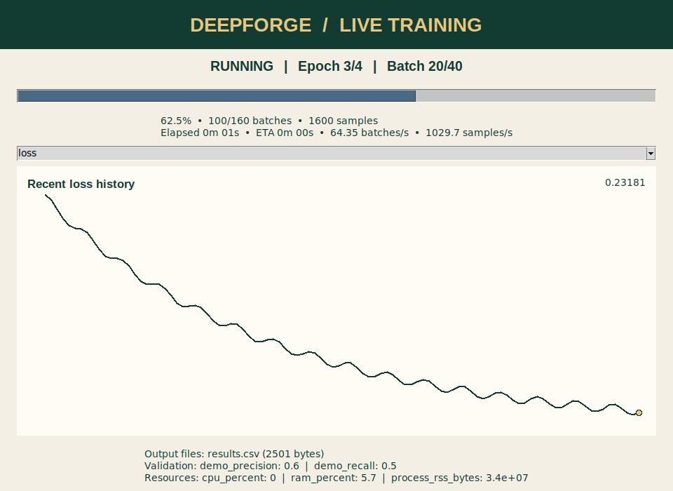

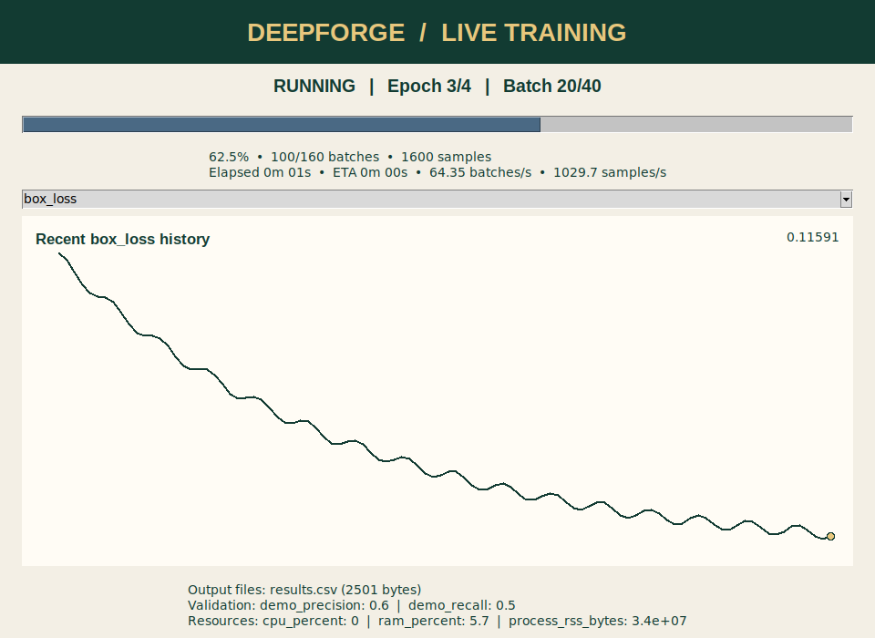

The following image shows the actual notebook renderer output opened in a browser, not a hosted Jupyter session.


[Open the notebook HTML example](https://raw.githubusercontent.com/AliRezaKhatibi/DeepForge/main/docs/images/live-notebook.html).

### Reproducing live monitor screenshots

The [Live monitor gallery workflow](https://github.com/AliRezaKhatibi/DeepForge/actions/workflows/live-gallery.yml) runs the actual desktop viewer under Xvfb and captures its window using synthetic metrics. Download the `deepforge-live-gallery` artifact from a successful run. The HTML file is the actual notebook renderer output; a browser capture illustrates that HTML, not a hosted Jupyter session. These are demonstrations, not trained-model benchmarks.

## Model architecture profiler (0.7)

```bash
deepforge profile-mlp --inputs 16 --hidden 32 --outputs 3 --batch 8
```

```python
import torch
from deepforge.profiler import profile_model

model = torch.nn.Sequential(torch.nn.Linear(16, 32),
                            torch.nn.ReLU(), torch.nn.Linear(32, 3))
report = profile_model(model, torch.zeros(8, 16), warmup=2, repeats=5)
print(report["estimated_macs"], report["estimated_flops_2x_macs"])
print(report["calls"])
```

The Model workspace now profiles the built-in MLP, with executed call details in Findings and JSON/HTML reports. Arbitrary trusted, already initialized models are supported through Python, including keyword and nested inputs. The example `examples/profile_architecture.py` exports a self-contained HTML report.

**Counting convention:** standard Linear and Conv1d/2d/3d leaf-module calls only, including groups, output dimensions, repeated calls and batch size. One multiply-accumulate is counted as two FLOPs. Bias, activation, normalization, pooling, attention and functional operations are not counted. Unsupported leaf types are reported, but functional operations can remain invisible. This is a partial estimate, not a complete architecture FLOP count or a substitute for a paper's reporting convention. Registered modules, registered leaf modules, and executed leaf calls are distinct; shared parameters are deduplicated in the global inventory, not necessarily in per-module rows.

Latency measures a complete uninstrumented forward after warmup, on CPU or synchronized CUDA devices, with median and nearest-rank p95 in milliseconds. Set repeats=0 to disable timing. Measurements depend on batch size, hardware and load. The logical output byte sum is not peak activation memory; CUDA allocator before/after values are process-wide, not model-specific peak VRAM. Model evaluation flags and hooks are restored, but arbitrary custom forwards can still mutate state or consume RNG; profile trusted code only, never concurrently on a training model. GPU timing is not yet verified on real CUDA hardware by CI.

### Extended operator and CUDA peak profiling (0.7.1.1.2)

```python
from deepforge.profiler import profile_operators, profile_cuda_peak

ops = profile_operators(model, example_input)
print(ops["estimated_flops"], ops["operators"])
# For CUDA models/inputs only, when no other CUDA work is running:
# peak = profile_cuda_peak(model, example_input)
```

The operator report uses the native PyTorch profiler's partial FLOP estimates, including selected matrix multiplications and 2-D convolution operations. It is independent of the module-hook estimator: **never add the two totals**. Operators without a positive estimate are listed, not assumed free. CPU event timings include instrumentation overhead and are not device latency.

The explicitly opt-in CUDA peak function resets process-wide allocator peak counters for the known CUDA devices, performs a single evaluation forward, and returns baseline and peak allocation/reservation. It cannot restore old peak counters and is not an isolated measurement of model memory or training VRAM. Do not call it while training or profiling concurrent workloads. Actual CUDA hardware is not available in the CPU CI matrix; the CUDA-only test skips when unavailable.

The Model Inspector now accepts batch size, charts per-layer estimated MACs, and shows compact input/output shape rows in Findings. The following images were captured from the running Model Inspector under Linux/Xvfb using a synthetic, randomly initialized MLP (64 → 128 → 10, batch size 8). The latency values describe the CI capture machine and are not a hardware benchmark.

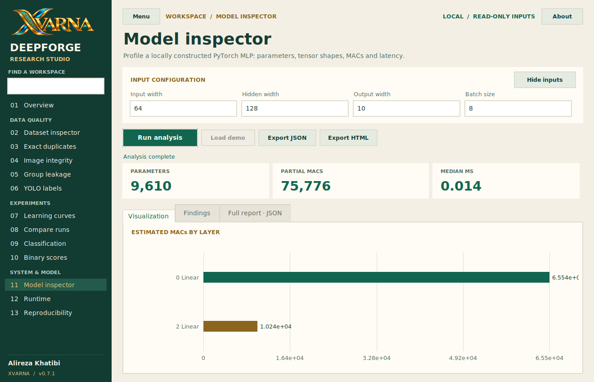

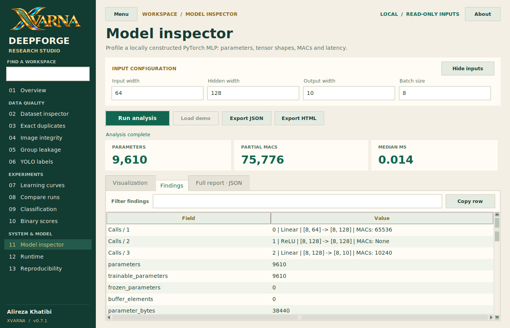

[Open the matching HTML architecture report](https://raw.githubusercontent.com/AliRezaKhatibi/DeepForge/main/docs/images/architecture-report.html). The gallery workflow reproduces these screenshots and the report.

## Training analytics and persistent events (0.6)

```python
from deepforge.monitor import TrainingMonitor

monitor = TrainingMonitor("live.json", epochs=10, batches_per_epoch=20,
                          archive="events.jsonl",
                          diagnostics={"train_key": "train_loss", "val_key": "val_loss"})
monitor.batch(epoch=1, batch=1, samples=3, metrics={"loss": 0.7},
              labels=[0, 0, 1])
# Optional: publish an explicitly selected, already annotated image:
# monitor.record_preview("annotated_batch.png")
```

Call batch for every completed batch in sequence and epoch_end after each completed epoch with comparable scalar train/validation losses. Diagnostics flag possible overfitting or a loss plateau over the configured window, not causal diagnoses of overfitting or underfitting. Optional gradient thresholds require the caller to record gradient_norm and configure thresholds appropriate for the model. Class counts are label counts (objects for detection), not automatically inferred images or dataset-wide imbalance. The preview is opt-in, requires Pillow, stores a bounded PNG in the snapshot and notebook output, and never uploads data. Do not publish private image content or reports. The optional JSONL archive records all batch/epoch events, not images; it must be a new file, is single-writer, and does not implement checkpoint resume.

Ultralytics callbacks record learning rates when exposed and ignore repeated final validation callbacks. The CI smoke job exercises a pinned YOLO release on CPU with generated images and labels; the job result is the verification record. Automatic extraction of YOLO batch tensors and sample counts, GPU utilization, resume, and architecture FLOPs are not implemented by this change. See the previous gallery for the established desktop UI; new diagnostics screenshots are not yet captured.

## Tests and release verification

```bash
python -m pip install -e '.[dev]'
python -m pytest -q
```

On Linux with a virtual display, exercise the actual desktop interface using:

```bash
xvfb-run -a python -m pytest -q
```

The CI workflow targets Windows and Linux on Python 3.10, 3.13 and 3.14, and includes a separate Linux CPU PyTorch job. Its remote results remain unverified until publication. The release preparation tests, environment and limitations are recorded in [docs/VALIDATION.md](docs/VALIDATION.md).

## Privacy and safe use

- Reports may contain relative paths, class labels, input filenames or detailed error text. Review and redact before sharing.
- Inputs and reports stay local unless you explicitly share them. There is no network API or telemetry in the toolkit.
- Do not treat the leakage, label or calibration audits as guarantees of dataset independence, correctness, safety or clinical performance.
- See [SECURITY.md](SECURITY.md) for vulnerability reporting and [CONTRIBUTING.md](CONTRIBUTING.md) for contribution guidance.

## Roadmap

Future work: scalable similarity indexing, per-image annotation preview, group-aware split planning, detection mAP, safe model profiling, saved project workspaces, accessibility refinements, and signed desktop installers. No release dates are promised.

## License

DeepForge is distributed under the MIT license. See [LICENSE](LICENSE). Third-party dependencies retain their own licenses. The project is not affiliated with PyTorch or Ultralytics.

## Smart checkpoint recovery

Create a JSON configuration in Studio using the Checkpoint button, or write one manually with root, run_id and policy (enabled, keep_last, save_every_epochs, max_bytes). YAML requires PyYAML. A mounted Drive directory can be used as root, but remote filesystem durability and locking are not guaranteed.

```python
from deepforge.checkpoint_config import load_checkpoint_config
from deepforge.checkpoint_torch import TorchCheckpoint

store = load_checkpoint_config("checkpoint.json")
# Construct model and optimizer before restoring.
# adapter = TorchCheckpoint(store, model, optimizer, scheduler=scheduler)
# metadata = {"dataset_fingerprint": "...", "seed": 42, "settings": {}}
# adapter.save_epoch(epoch, global_step=step, metadata=metadata)
# state = adapter.restore_latest(expected_metadata=metadata)
# Continue at state["epoch"] + 1.
```

Call save_epoch after each completed epoch. Supply dataset fingerprints, splits, augmentation settings and other provenance in metadata. Inspect verified records with `deepforge checkpoint ROOT RUN_ID`. After a crash, only after confirming all writers have stopped, call `store.recover_abandoned_lock(confirmed_no_writer=True)`. Checksums detect corruption, not malicious modification. Use trusted storage. Exact resume depends on framework, sampler, hardware and deterministic operations; mid-epoch progress is not guaranteed. Studio exports configuration rather than modifying running training scripts.

## Epoch dashboard (0.7.1.1.2)

The notebook dashboard retains recent epoch cards and plots recorded loss and accuracy. Configure `NotebookMonitor(path, max_epochs=12, theme="jade", show_stages=True, show_charts=True, show_resources=True)`. Themes: jade, light, dark. Overall progress counts training batches only.

After training batches for an epoch, report validation with `monitor.record_stage(epoch, "validation", "running", completed=0, total=len(val_loader))`, update completed counts, call `monitor.epoch_end(epoch, metrics)`, and mark validation completed. Call `view.refresh(force=True)` to display stage transitions. Record hardware samples explicitly with `monitor.record_resources(sample_resources())` from `deepforge.resources`.

Pass `monitor=monitor, refresh=lambda: view.refresh(force=True)` to TorchCheckpoint or attach_yolo_checkpoint to report checkpoint and verification stages. The monitor must already have recorded the corresponding training batches. Saves are synchronous; no byte-level progress is inferred. Disabled or unscheduled saves are marked skipped. GPU memory usage is not GPU compute utilization. Existing callers need not supply these options.

### Fixed notebook header

`NotebookMonitor(path, dashboard_height=480, fixed_header=True, max_epochs=20)` keeps the summary outside the independently scrolling details region and shows the latest 20 reached epochs, oldest first within the latest reached epochs, with the newest at the bottom. Earlier epochs remain in the snapshot and automatic `<snapshot>.epochs.jsonl` log. Set `max_epochs=None` to render all cards. Notebook output replacement may reset scroll position or expanded details; the header remains outside the inner scroll area. The default epoch log appends run start, training epoch, validation, stage and finish events; explicit archive paths retain batch events too.


### Interactive PyTorch sessions (0.7.1.1.2)

Install the optional `interactive` extra for notebook widgets. Run
`setup_panel("config.json")` from `deepforge.notebook_setup` in a separate
cell and save the configuration before building the session.

```python
from deepforge.notebook_setup import build_training_session
monitor, view, checkpoint, session = build_training_session(
    "config.json", run_id="experiment_001", epochs=50,
    batches_per_epoch=len(train_loader), model=model, optimizer=optimizer,
    experiment_metadata={"dataset_fingerprint": dataset_fingerprint},
)
session.controls()
# On a fresh process, explicitly restore a paused session:
# state = session.restore()
# start_epoch = state["epoch"] + 1
# After each epoch's training, validation and scheduler updates:
# monitor.epoch_end(epoch, {"loss": validation_loss})
# if session.epoch_boundary(epoch, global_step=global_step):
#     break
# checkpoint.save_epoch(epoch, global_step=global_step, metadata=session.metadata)
```

Record training loss as `loss` and validation loss as `loss` in
`epoch_end`. Warnings are heuristic, never automatic stopping decisions.
Cards are chronological, with the latest 20 by default. Earlier records
remain in the JSONL log. Browser audio autoplay and widget callbacks during
a blocking training cell are frontend-dependent; use a cooperative loop
or a supported external control mechanism. The recovery API requires an
identically configured model and dataset; it does not recreate user code.

## Complete training quickstart: Colab, Kaggle, Jupyter and VS Code

The distribution name is **deepforge-research-toolkit**, while the Python import is **deepforge**. The following examples target release 0.7.1.1.3.

### 1. Installation and environment

In Colab or Kaggle, run in a notebook cell (enable Internet in Kaggle for downloads):

```python
%pip install "deepforge-research-toolkit[interactive,resources]==0.7.1.1.3"
```

In Colab only, enable widgets:

```python
from google.colab import output
output.enable_custom_widget_manager()
```

For VS Code or local Jupyter, create an environment in a terminal:

```bash
python -m venv .venv
# Windows PowerShell: .venv\Scripts\Activate.ps1
# Linux/macOS: source .venv/bin/activate
python -m pip install "deepforge-research-toolkit[interactive,resources]==0.7.1.1.3" ipykernel jupyterlab
python -m pip install torch torchvision
python -m ipykernel install --user --name deepforge-demo
```

For GPU use, install the appropriate PyTorch build from https://pytorch.org/get-started/locally/ instead of assuming the default wheel supports your hardware. In VS Code install the Python and Jupyter extensions, open an .ipynb file and select the deepforge-demo kernel. For JupyterLab run `jupyter lab`. Hosted notebooks normally already provide torch and torchvision; avoid replacing working CUDA builds unnecessarily. Restart the kernel after changing already-imported dependencies.

```python
from importlib.metadata import version
import torch
print(version("deepforge-research-toolkit"))
print(torch.cuda.is_available())
```

### 2. Independent classification demo

Run this cell once. The example uses a fixed disjoint subset of MNIST training data; the official test split is untouched. This is a functional demo, not a benchmark.

```python
import hashlib
import json
import uuid
from pathlib import Path
import torch
from torch import nn
from torch.utils.data import DataLoader, Subset
from torchvision.datasets import MNIST
from torchvision.transforms import ToTensor

torch.manual_seed(42)
device = torch.device("cuda" if torch.cuda.is_available() else "cpu")
EPOCHS = 5
dataset = MNIST("data", train=True, download=True, transform=ToTensor())
indices = torch.randperm(len(dataset), generator=torch.Generator().manual_seed(42)).tolist()
train_ids, val_ids = indices[:12000], indices[12000:15000]
train_loader = DataLoader(Subset(dataset, train_ids), batch_size=128, shuffle=True, num_workers=0)
val_loader = DataLoader(Subset(dataset, val_ids), batch_size=128, shuffle=False, num_workers=0)
fingerprint = hashlib.sha256(json.dumps([train_ids, val_ids]).encode()).hexdigest()

def make_model():
    model = nn.Sequential(nn.Flatten(), nn.Linear(784, 128), nn.ReLU(), nn.Linear(128, 10)).to(device)
    optimizer = torch.optim.Adam(model.parameters(), lr=0.001)
    return model, optimizer

model, optimizer = make_model()
criterion = nn.CrossEntropyLoss()
```

### 3. Configure the dashboard

```python
from deepforge.notebook_setup import setup_panel
setup_panel("deepforge_config.json")
```

Select metrics, theme, refresh interval, visible epoch count, hardware sampling, warning sensitivity, audio and checkpoint retention. Click **Save configuration** before continuing. Select a durable storage path for recovery across runtimes. In Colab, optionally mount Drive first:

```python
from google.colab import drive
drive.mount("/content/drive")
# Enter /content/drive/MyDrive/deepforge_runs in Storage path.
```

Local Colab storage disappears when the runtime is deleted. Kaggle working storage must be exported or saved as an output; a new session is not guaranteed to retain it. Drive filesystem durability is not guaranteed.

### 4. Create a fresh session

```python
from deepforge.notebook_setup import build_training_session
from deepforge.training import TrainingGuard

RUN_ID = "mnist_" + uuid.uuid4().hex[:12]
metadata = {"dataset": "MNIST", "split_fingerprint": fingerprint,
            "model": "MLP128", "batch_size": 128, "seed": 42}
def make_session():
    return build_training_session(
        "deepforge_config.json", run_id=RUN_ID, epochs=EPOCHS,
        batches_per_epoch=len(train_loader), model=model,
        optimizer=optimizer, experiment_metadata=metadata)

monitor, view, checkpoint, session = make_session()
guard = TrainingGuard(model, max_gradient_norm=100)
session.controls()
view.refresh(force=True)
print(RUN_ID, session.root)
```

Keep RUN_ID and the saved configuration for recovery. For a new independent experiment recreate model and optimizer, then generate a new RUN_ID and monitor. Do not reuse a completed monitor.

### 5. Training, validation and verified checkpoints

Run the following cell. Set demo_stop=True to test safe pause reproducibly without depending on browser callbacks.

```python
def train(start_epoch=1, global_step=0, demo_stop=False):
    assert monitor.status == "running"
    assert monitor.batches == len(train_loader)
    assert monitor.completed == (start_epoch - 1) * monitor.batches
    assert len(val_loader) > 0
    try:
        for epoch in range(start_epoch, EPOCHS + 1):
            model.train()
            loss_sum = correct = count = 0
            for batch, (x, y) in enumerate(train_loader, 1):
                x, y = x.to(device), y.to(device)
                optimizer.zero_grad(set_to_none=True)
                logits = model(x)
                loss = criterion(logits, y)
                loss.backward()
                guard.before_step(loss)
                norm = sum(p.grad.detach().float().square().sum().item()
                           for p in model.parameters() if p.grad is not None) ** 0.5
                optimizer.step()
                global_step += 1
                loss_sum += loss.item() * y.size(0)
                correct += (logits.argmax(1) == y).sum().item()
                count += y.size(0)
                monitor.batch(epoch=epoch, batch=batch, samples=y.size(0),
                              metrics={"loss": loss_sum/count, "accuracy": 100*correct/count,
                                       "lr": optimizer.param_groups[0]["lr"], "gradient_norm": norm})
                session.poll_control()
                view.refresh()
            model.eval()
            loss_sum = correct = count = 0
            monitor.record_stage(epoch, "validation", "running", completed=0, total=len(val_loader))
            with torch.no_grad():
                for batch, (x, y) in enumerate(val_loader, 1):
                    x, y = x.to(device), y.to(device)
                    logits = model(x)
                    loss_sum += criterion(logits, y).item() * y.size(0)
                    correct += (logits.argmax(1) == y).sum().item()
                    count += y.size(0)
                    monitor.record_stage(epoch, "validation", "running", completed=batch, total=len(val_loader))
                    view.refresh()
            monitor.epoch_end(epoch, {"loss": loss_sum/count, "accuracy": 100*correct/count})
            monitor.record_stage(epoch, "validation", "completed", completed=len(val_loader), total=len(val_loader))
            if demo_stop and epoch == 1:
                session.request_stop(after_next=True)
            if session.epoch_boundary(epoch, global_step=global_step):
                return
            checkpoint.save_epoch(epoch, global_step=global_step, metadata=session.metadata)
            view.refresh(force=True)
        monitor.finish()
    except Exception:
        if monitor.status == "running":
            monitor.finish(failed=True)
        raise
    finally:
        view.refresh(force=True)

train(demo_stop=True)
```

Expected demo outcome: paused after epoch 2 of 5, with validation and verified recovery checkpoint. Set demo_stop=False for uninterrupted training. Accuracy is expressed as a percentage. Add scheduler.step() before epoch_boundary if using a scheduler and pass that scheduler to build_training_session. Precision, recall, F1 and detection mAP must be computed by the caller; selecting a metric does not calculate it automatically.

### 6. Resume a paused session

Recreate the same architecture, optimizer, data split, epoch count, configuration and RUN_ID. In a fresh runtime rerun the definitions above without generating a different RUN_ID or starting training first.

```python
model, optimizer = make_model()
monitor, view, checkpoint, session = make_session()
guard = TrainingGuard(model, max_gradient_norm=100)
state = session.restore()
session.controls()
train(start_epoch=state["epoch"] + 1, global_step=state["global_step"])
```

Expected outcome: epochs 3 through 5, status completed. The recovery adapter restores model, optimizer, Python/PyTorch RNG and optional supplied stateful components. Exact reproducibility is not guaranteed across hardware, workers or nondeterministic operations. The example fingerprint identifies split indices, not dataset file contents; use full dataset provenance for research. Do not call restore twice for the same paused state. Use trusted checkpoints only.

### 7. Warning and sound smoke test

```python
from deepforge.notebook_setup import AudioAlerts
AudioAlerts(enabled=True).notify(1, "Severe overfitting warning")
```

This tests audio output, not real overfitting. Actual warnings depend on recorded training and validation loss trends. Browser autoplay may require interaction. Widget stop callbacks may be delayed by a blocking notebook cell; the programmatic demo above is the reliable boundary test. No automatic early stopping is implied.

### 8. Terminal and troubleshooting

For a regular Python script use TrainingMonitor and the same batch/epoch API without notebook widgets. In a second local terminal run `deepforge-live PATH_TO_RUN/live.json` to view the desktop monitor. A separate process can queue a stop using the run's control file:

```python
from deepforge.control import StopControl
StopControl("PATH_TO_RUN/control.json").request(after_next=True)
```

Replace PATH_TO_RUN with the printed session.root. The training loop must poll control and honor epoch_boundary. For headless servers use the JSON snapshot and epoch JSONL archive instead of Tk.

| Error | Resolution |
| --- | --- |
| No matching distribution | Use deepforge-research-toolkit, not deepforge, and check the requested version and Python compatibility. |
| Monitor already finished | Create a new session for a new run; use restore for a paused run. |
| val_loader is not defined | Execute the dataset cell before training. |
| Epoch training has not completed or monitor has stopped | Match batches_per_epoch to len(train_loader), record every batch in order, and validate only after the last training batch. |
| Configuration file missing | Click Save configuration in the setup cell. |
| Widget output missing | Select the correct kernel, enable Colab widgets if applicable, and restart after dependency changes. |
| JavaScript text causes SyntaxError | Remove browser stack traces from Python cells; copy only code. |
| PyPI file already exists | The release file cannot be overwritten; verify the published version instead of repeatedly uploading. |

The dashboard is not a trainer: the caller owns data, model, optimization and validation. Hosted browser behavior and GPU recovery require environment-specific testing. These examples are documentation, not a claim of successful execution on every platform.
