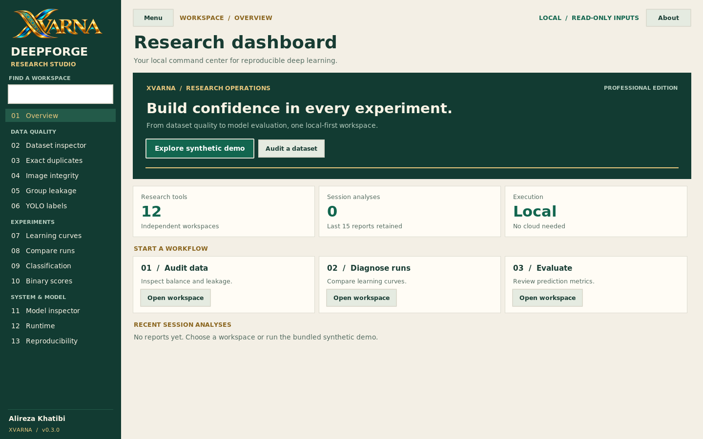
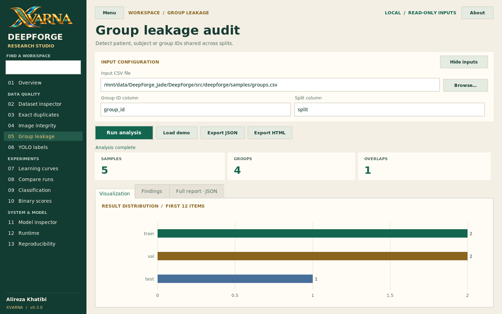
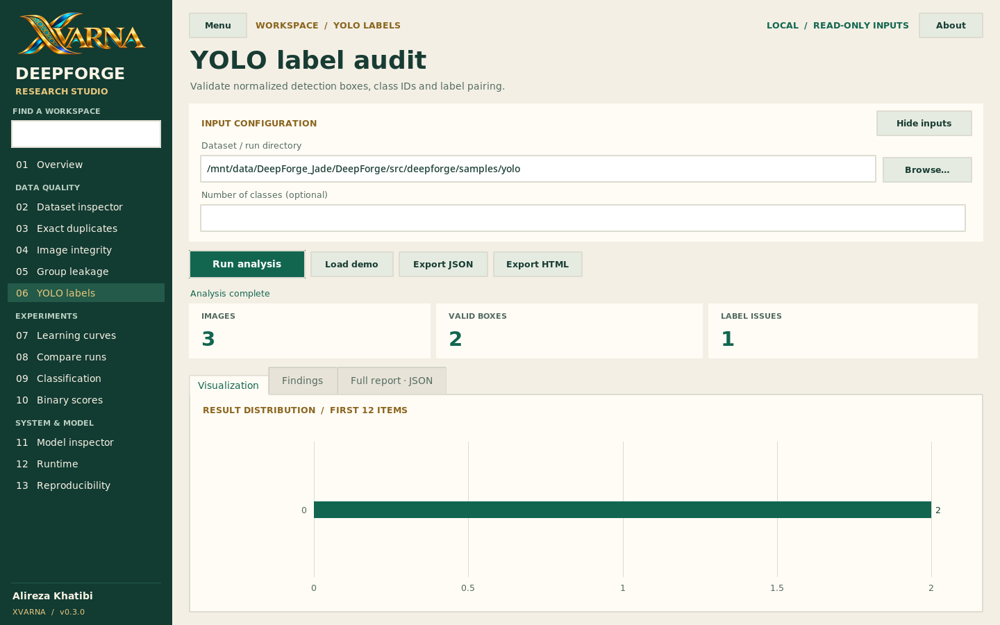
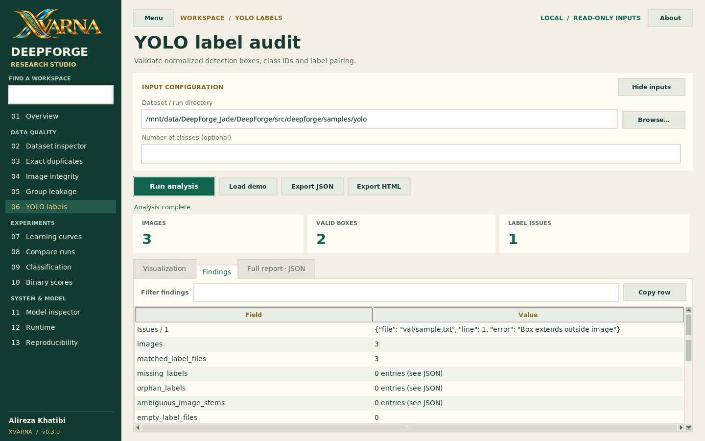
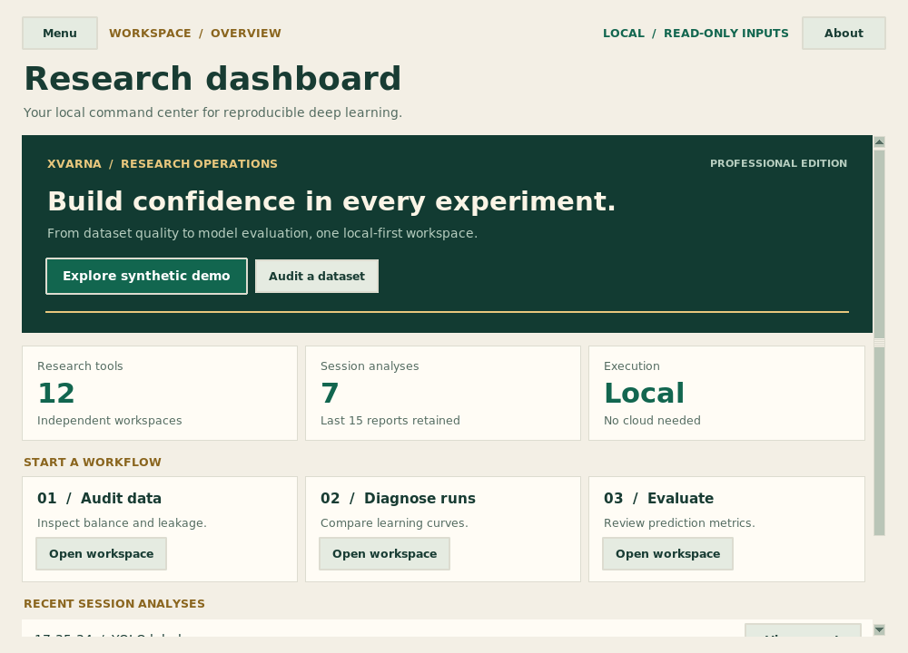

<div align="center">
  
  <h1>DeepForge Studio</h1>
  <p><strong>Professional Research Toolkit · Jade Edition</strong></p>
  <p>Created by <strong>Alireza Khatibi</strong> · XVARNA</p>
</div>

  

**Inspect · Validate · Evaluate · Reproduce**

DeepForge is a local-first research toolkit for deep learning and computer vision. It brings dataset quality checks, leakage audits, YOLO label validation, experiment diagnostics, classification evaluation, model inspection, and reproducibility reporting into one Python package with a desktop interface and a scriptable command-line API.

DeepForge Studio is an early-stage open-source project. Version 0.3.0 is a release candidate for research and development, not a clinically validated product or a certified production service. It is not yet published on PyPI.



## Install and launch

Python 3.10 or later is required. The core toolkit uses only the standard library. Pillow enables image decoding and similarity analysis; PyTorch is optional for model inspection. Tkinter is required only for the desktop application.

### Windows

Extract the source archive and open its `DeepForge` directory. With Python on PATH, run `scripts\setup-windows.cmd` and then `scripts\launch-windows.cmd`. The setup script creates a project-specific `.venv` and installs the image-analysis dependency. Alternatively, use your existing Python environment:

```powershell
python -m pip install -e ".[images]"
python -m deepforge.gui
```

### Linux / macOS

```bash
python -m venv .venv
source .venv/bin/activate
python -m pip install -e '.[images]'
deepforge-studio
```

A standard Tk installation is needed. On Debian/Ubuntu, install `python3-tk` if your Python distribution does not already include Tk. Check with `python -m tkinter`. Install PyTorch for your hardware using the official [PyTorch installation guide](https://pytorch.org/get-started/locally/) rather than assuming a CUDA build is appropriate. For a default PyTorch installation, `python -m pip install -e '.[torch]'` is also available.

The Windows launch scripts have been inspected but not run on Windows in the release preparation environment. The actual desktop UI was exercised on Linux with a virtual display. GPU execution has not been validated.

## Research workspaces

| Workspace | Purpose | CLI command |
| --- | --- | --- |
| Dataset Inspector | Split and class counts for image classification | `dataset` |
| Exact Duplicates | SHA-256 cross-split duplicate groups | `leakage` |
| Image Integrity | Decode images, inspect resolution/mode, flag perceptual similarities | `images` |
| Group Leakage | Detect group, subject, or patient IDs shared across splits | `groups` |
| YOLO Labels | Check detection labels, class ranges, missing/orphan pairs, invalid boxes | `yolo` |
| Learning Curves | Best epoch, final metric, possible overfitting signal | `history` |
| Compare Runs | Rank validation histories and identify rejected CSV files | `compare` |
| Classification | Accuracy, macro/weighted precision, recall, F1 and confusion matrix | `metrics` |
| Binary Scores | ROC-AUC, average precision, threshold metrics, Brier score and ECE | `scores` |
| Model Inspector | Parameters and logical tensor sizes for a configurable MLP | Python API |
| Runtime | Python, PyTorch and optional CUDA information | `env` |
| Reproducibility | Dependency versions and optional input-file SHA-256 | `manifest` |

### Studio features

- A navigable research dashboard, 12 independent workspaces, with a jade, cream and gold visual identity, collapsible sidebar and searchable navigation. Compact windows automatically collapse the input panel after analysis to leave room for the chart.
- Workspace input values are retained during the session. Search findings, copy individual rows, and hover over plotted points for precise values.
- Explore binary decision thresholds interactively with live precision, recall and F1 previews; Apply explicitly recomputes the report. Threshold selection belongs on validation data, not the final test set.
- Background analysis keeps the UI event loop responsive; analyses are run sequentially within a window.
- Learning curves, confusion matrices, distribution bars, ROC, precision-recall and reliability diagrams.
- A findings table and full JSON report; JSON and self-contained HTML export with embedded chart previews matching the selected ROC, precision-recall or calibration view.
- The last 15 successful analyses are available in session memory. Closing the application clears that history unless reports were explicitly exported.
- Nine workspaces have bundled, clearly synthetic demo inputs. Demo data intentionally includes leakage and label issues to exercise the audits.
- No account, cloud service or telemetry is required. Input analyses are read-only, and report exports are written to a user-selected output path.


<details>
<summary>Explore more real application screenshots</summary>










</details>

All screenshots were captured from the running desktop application with bundled synthetic inputs. No private datasets are included.

### Keyboard shortcuts

| Shortcut | Action |
| --- | --- |
| Ctrl+K | Find a workspace |
| Ctrl+B | Toggle sidebar |
| Ctrl+Enter | Run analysis |
| Ctrl+S | Export JSON |

### Branding

DeepForge Studio was created by Alireza Khatibi under the XVARNA identity. The supplied XVARNA logo was refined into a transparent raster asset for the desktop application and documentation. The software uses the MIT license; brand identity and logo usage are separate from the software license.

## CLI quick examples

Run `deepforge --help` or `python -m deepforge --help` for arguments. All CLI reports are JSON. Exit code 2 indicates an invalid input or I/O error. The `leakage` and `groups` commands can return 1 with `--fail-on-leakage` when the respective audit detects overlap.

```bash
deepforge dataset ./dataset
deepforge leakage ./dataset --fail-on-leakage
deepforge images ./dataset --similarity --threshold 4 --max-images 2000
deepforge groups examples/groups.csv --fail-on-leakage
deepforge yolo ./detection_dataset --classes 3
deepforge history examples/history.csv --train-metric train_loss
deepforge compare examples/runs --train-metric train_loss
deepforge metrics examples/predictions.csv
deepforge scores examples/scores.csv --positive-label 1 --threshold 0.5
deepforge env
deepforge manifest examples/history.csv
```

## Input formats and interpretation

### Classification datasets and image audits

```
dataset/
  train/cat/a.png
  train/dog/b.jpg
  val/cat/c.png
  test/dog/d.jpg
```

`dataset` and `leakage` expect class directories under `train`, `val` (or `validation`), and/or `test`. The first counts supported extensions without decoding; the second groups identical file bytes by SHA-256. `images` accepts both class folders and images directly beneath split folders. It uses Pillow, corrects EXIF orientation for inspected sizes and hashes, flags decode failures and reports unsupported DICOM inputs without parsing them.

Perceptual similarity is a 64-bit difference hash (dHash) compared by Hamming distance across different splits. The exhaustive comparison is bounded to a configurable, deterministic first 1–5,000 image candidates (default 2,000); pair previews are capped, and reports include explicit truncation indicators. It may miss cropped, rotated or otherwise transformed images, and unrelated flat images can collide. These are candidate matches requiring review, not proof of duplicate identity. Clean reports do not establish patient independence. The image audit inspects a single frame of multi-frame images and rejects images exceeding 40 megapixels.

### Group-aware leakage

```csv
group_id,split
subject-a,train
subject-a,val
subject-b,test
```

The manifest must include complete, correct group IDs. Use patient-level identifiers in medical imaging where ethically permitted; do not upload real identifiers or datasets to GitHub. Raw IDs are replaced with local report pseudonyms by default; this is not guaranteed anonymization. `--show-identifiers` is an explicit CLI opt-in. Group audits do not infer patient identities from filenames or image content.

### YOLO object detection

```
detection_dataset/
  images/train/a.jpg
  labels/train/a.txt
  images/val/b.jpg
  labels/val/b.txt
```

Each detection row has five fields: `class_id x_center y_center width height`. Coordinates must be finite and normalized, and box dimensions must be positive. The audit flags out-of-frame boxes, duplicate rows, invalid class IDs (upper bound only when `--classes` is supplied), ambiguous image stems and missing/orphan label files. Empty label files may correctly represent background images. This does not inspect semantic annotation correctness, YAML dataset definitions, segmentation polygons, or pose keypoints.

### Experiment diagnostics

Use CSV files with strictly increasing numeric epochs and finite numeric validation values. `--mode min` selects the smallest metric, while `--mode max` selects the largest. The earliest epoch wins ties. If a comparable training metric improves while validation deteriorates after the best epoch, the result is a possible overfitting signal, not a causal diagnosis. `compare` processes CSV files in one directory (default cap 100) and ranks reported best validation metrics; compare only runs with equivalent evaluation protocols and appropriate budgets.

### Classification and probability scores

Use `y_true,y_pred` for single-label predictions. Confusion matrix rows are true labels, columns predicted labels, using sorted observed labels. Undefined precision/recall/F1 are zero.

For binary probability evaluation, use `y_true,score`, specifying the positive class and decision threshold. Scores must be finite probabilities in [0,1], and exactly two observed classes are required. ROC-AUC integrates the ROC curve; average precision uses recall increments at grouped score thresholds (including ties). Brier score measures probability squared error, while ECE depends on the equal-width bins selected. Calibration is descriptive, not a guarantee of trustworthy predictions. Tune thresholds on validation data, not the final test set. Detection mAP, multiclass probability curves and multilabel metrics are not implemented.

### PyTorch model inspection

```python
import torch
from deepforge.models import inspect_model

model = torch.nn.Sequential(
    torch.nn.Linear(16, 32),
    torch.nn.ReLU(),
    torch.nn.Linear(32, 3),
)
print(inspect_model(model))
```

The desktop Model workspace constructs a limited configurable MLP; the Python API accepts a model you have already constructed. It never loads arbitrary checkpoints or evaluates user-supplied Python source. Parameter/buffer counts deduplicate tensor objects, but shared underlying storage can be counted more than once. Logical byte estimates are not activation memory, optimizer memory, peak GPU memory, latency or FLOPs. Initialize lazy modules before inspection.

## Python API

```python
from deepforge.audit import audit_groups, audit_yolo, audit_images
from deepforge.advanced import read_binary_scores, compare_runs

report = audit_groups('examples/groups.csv')
print(report['overlapping_groups'])
report = read_binary_scores('examples/scores.csv')
print(report['roc_auc'])
```

## Tests and release verification

```bash
python -m pip install -e '.[dev]'
python -m pytest -q
```

On Linux with a virtual display, exercise the actual desktop interface using:

```bash
xvfb-run -a python -m pytest -q
```

The CI workflow targets Windows and Linux on Python 3.10, 3.13 and 3.14, and includes a separate Linux CPU PyTorch job. Its remote results remain unverified until publication. The release preparation tests, environment and limitations are recorded in [docs/VALIDATION.md](docs/VALIDATION.md).

## Privacy and safe use

- Reports may contain relative paths, class labels, input filenames or detailed error text. Review and redact before sharing.
- Inputs and reports stay local unless you explicitly share them. There is no network API or telemetry in the toolkit.
- Do not treat the leakage, label or calibration audits as guarantees of dataset independence, correctness, safety or clinical performance.
- See [SECURITY.md](SECURITY.md) for vulnerability reporting and [CONTRIBUTING.md](CONTRIBUTING.md) for contribution guidance.

## Roadmap

Future work: scalable similarity indexing, per-image annotation preview, group-aware split planning, detection mAP, safe model profiling, saved project workspaces, accessibility refinements, and signed desktop installers. No release dates are promised.

## License

DeepForge is distributed under the MIT license. See [LICENSE](LICENSE). Third-party dependencies retain their own licenses. The project is not affiliated with PyTorch or Ultralytics.
